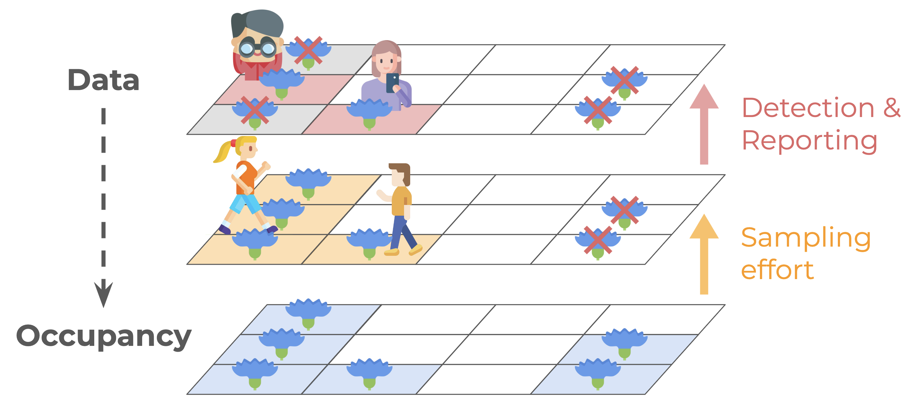
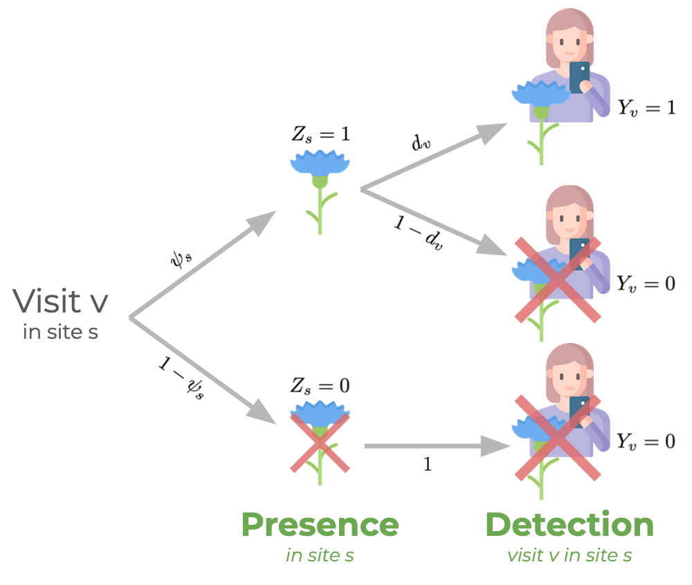

<p align="center">
  
</p>

**OccuPYcy** is an open-source <u>**PY**</u>thon package for site-<u>**occu**</u>pan<u>**cy**</u> modeling at scale. OccuPYcy provides tools for flexible, high-performance fitting of single or multi-species occupancy models using maximum likelihood with (stochastic) gradient-based optimization in [PyTorch](https://pytorch.org/). It is designed for scalability, deep model expressivity, and robust application to massive, uneven datasets—such as those from citizen science.

## Features

- **Flexible Model Definitions:** Use linear, non-linear, or neural networks for occupancy and detection probabilities via PyTorch modules.
- **Extensible:** Define custom architectures and features for modern site-occupancy modeling.
- **Supports Large, Heterogeneous Datasets:** Memory mapping and efficient batching for millions of observations with highly uneven visits per site. Suited for citizen science data with variable sampling and detection effort.
- **Multiple Optimizers:** LBFGS, SGD, Adam, and other first- and second-order optimizers.
- **Penalized Estimation:** Easily apply L1/L2 regularization and other penalties.
- **Open Source:** code available on GitHub under the MIT License, soon on PyPI. *A scientific publication describing and applying the method is in preparation.*

## Installation

We recommend using [uv](https://github.com/astral-sh/uv) for reproducible local development.  
*Python ≥3.8 and PyTorch ≥2.0 required.*

### Quick local setup:

```bash
uv venv
uv pip install -e ".[dev]"
uv run pytest -q
```

If not using `uv`:
```bash
python3 -m venv .venv
source .venv/bin/activate
pip install -U pip
pip install -e ".[dev]"
pytest -q
```

## Quick Start Example

```python
from occupycy import SiteOccupancyModel
import torch

# Example: single-species with linear predictors
model = SiteOccupancyModel(
    n_site_features=5, 
    n_obs_features=2, 
    architecture='linear',
    device='cpu'
)

# X_sites: [n_sites, n_site_features]
# U_visits: [n_visits, n_obs_features]
# y: detection labels [n_visits]

X_sites = torch.randn(1000, 5)
U_visits = torch.randn(10000, 2)
y = torch.randint(0, 2, (10000,))

loss = model.loss(X_sites, U_visits, y)
loss.backward()
# Use your preferred optimizer, or call model.fit(...)
```

See the [examples/](examples/) folder and documentation for more advanced use cases, including multi-species, deep MLP models, and efficient minibatch training on large datasets.


## Site-Occupancy Framework on Citizen Science Data


<p align="center">
  
</p>

<p align="center">
  
</p>

## How to Cite

## License

OccuPYcy is licensed under the MIT License. See the [LICENSE](LICENSE) file for details.

## Project Links

- [Source code on GitHub](https://github.com/RaphBnrd/Plantnet-Trend-Estimation)
- [Example usage](examples/)
- For questions, contact [raphael.benerradi@inria.fr](mailto:raphael.benerradi@inria.fr)

---

*OccuPYcy was developed as part of ongoing research in scalable machine learning for ecology.*