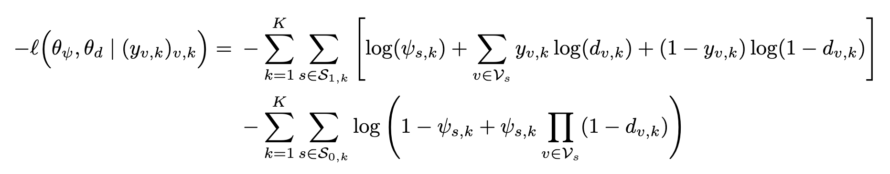

**OccuPYcy** is an open-source <strong><ins>PY</ins></strong>thon package for site-<strong><ins>occu</ins></strong>pan<strong><ins>cy</ins></strong> modeling at scale. OccuPYcy provides tools for flexible, high-performance fitting of single or multi-species occupancy models using maximum likelihood with (stochastic) gradient-based optimization in [PyTorch](https://pytorch.org/). It is designed for scalability, deep model expressivity, and robust application to massive, uneven datasets—such as those from citizen science.

## Table of Contents
- [Features](#-features)
- [Installation](#-installation)
- [Quick Start Example](#%EF%B8%8F-quick-start-example)
- [Site-Occupancy Framework](#-site-occupancy-framework)
- [How to Cite](#-how-to-cite)
- [Contributing & Collaboration](#-contributing--collaboration)
- [License](#-license)
- [Project Links](#-project-links)

# ✨ Features

- **Flexible Model Definitions:** Use linear, non-linear, or neural networks for occupancy and detection probabilities via PyTorch modules.
- **Extensible:** Define custom architectures and features for modern site-occupancy modeling.
- **Supports Large, Heterogeneous Datasets:** Memory mapping and efficient batching for millions of observations with highly uneven visits per site. Suited for citizen science data with variable sampling and detection effort.
- **Multiple Optimizers:** LBFGS, SGD, Adam, and other first- and second-order optimizers.
- **Penalized Estimation:** Easily apply L1/L2 regularization and other penalties.
- **Open Source:** code available on GitHub under the MIT License, soon on PyPI. *A scientific publication describing and applying the method is in preparation.*

# 📦 Installation

We recommend using [uv](https://docs.astral.sh/uv/) for reproducible local development.  
*Python ≥3.10 and PyTorch ≥2.0 recommended.*


## Using OccuPYcy in another project

You can install OccuPYcy as a dependency in your project either from GitHub or from a local clone of the repository.

**From PyPI:** *(coming soon🤞)*

**From GitHub:** `hidden for anonymity reason`

**From the repository cloned on your machine:** 
After cloning OccuPYcy (see below), navigate to the repository root of your project, and install it in editable mode with: 
```bash
pip install -e /local/path/to/the/repository/OccuPYcy
```

## Source code download

If you want to setup a local development environment in the repository, move to the repository root (`cd occupycy`) and you can use `uv` or `venv` to create a virtual environment and install the dependencies.

```bash
uv venv
uv pip install -e ".[dev]"
uv run pytest -q
```

If not using `uv`:
```bash
python3 -m venv .venv
source .venv/bin/activate
pip install -U pip
pip install -e ".[dev]"
pytest -q
```

# ⚡️ Quick Start Example

Below is an example fitting a Multi-Layer Perceptron (MLP) occupancy model on simulated data.  
Other examples are available in the [examples/](examples/) folder. More details on the code below are available in the notebook [01-fitting_on_simulated_data.ipynb](examples/01-fitting_on_simulated_data.ipynb).


```python
import torch
import occupycy

seed = 1
torch.manual_seed(seed)
device = torch.device("cpu")

# 1. Simulate data (arbitrary non-linear functions)
def true_f_psi(X_psi): # here X_psi of shape (n_sites, n_cov_psi=2)
    return torch.sigmoid(
        - 0.5 * torch.cos(X_psi[:,0]) - 0.5 * (X_psi[:,1] ** 2)
    ).unsqueeze(1)
def true_f_d(X_d): # here X_d of shape (n_total_visits, n_cov_d=1)
    return torch.sigmoid(
        torch.tanh(5 * X_d[:,0]) - torch.cos(X_d[:,0])
    ).unsqueeze(1)

y, visit_site_ids, site_ids_in_X_psi, X_psi, X_d, true_z = \
    occupycy.data.simulate_non_linear(
        n_sites=5000,
        n_total_visits_max=int(1e4),
        n_cov_psi=2,
        n_cov_d=1,
        f_effort = lambda x: torch.distributions.LogNormal(0, 3).sample((x.shape[0],)),
        f_psi=true_f_psi,
        f_d=true_f_d,
        seed=seed,
        plot_summary=True,
        verbose=True
    )

# 2. Build OccuData (YOU CAN REPLACE THIS WITH YOUR OWN DATA)
# y: tensor of shape (n_total_visits, n_species) with the detection/non-detection data
# visit_site_ids: list of length (n_total_visits,) with the site id of each visit
# site_ids_in_X_psi: list of length (n_sites,) with the site ids of the rows in X_psi
# X_psi: tensor of shape (n_sites, n_cov_psi) with the covariates for occupancy
# X_d: tensor of shape (n_total_visits, n_cov_d) with the covariates for detection
data = occupycy.data.OccuData(
    y=y, 
    visit_site_ids=visit_site_ids,
    X_psi=X_psi,
    X_d=X_d,
    site_ids_in_X_psi=site_ids_in_X_psi
)

# 3. Define an MLP-MLP model
# (other architectures are possible, including custom ones)
model = occupycy.models.MLPOccuModel(
    n_species=1,
    n_cov_psi=data.X_psi.shape[1],
    n_cov_d=data.X_d.shape[1],
    hidden_dims_psi=[256, 256], hidden_dims_d=[256, 256],
    activation_fn_psi=torch.nn.ReLU, activation_fn_d=torch.nn.ReLU
)

# 4. Fit the model with Adam (LBFGS is also available)
res = occupycy.fit.fit_sgd_like(
    data, # OccuData object
    model, # OccuModel object
    n_epochs=1000, # maximum number of epochs
    val_fraction=0.15, # fraction of sites to use for validation
    batch_size=512, # number of sites per batch
    optimizer_psi_cls=torch.optim.Adam, # optimizer class for the occupancy part
    optimizer_d_cls=torch.optim.Adam, # optimizer class for the detection part
    lr_psi=1e-3, # learning rate for the occupancy part
    lr_d=1e-3, # learning rate for the detection part
    patience_early_stopping=100,
    patience_reduceLROnPlateau=20,
    device=device
)

# 5. Get the predictions
with torch.no_grad():
    pred_logit_psi, pred_logit_d = model.forward_logits(X_psi=X_psi.to(device), X_d=X_d.to(device))

```

NB: The [examples](/examples) are numbered in the order of increasing complexity (and readability...).

# 🌱 Site-Occupancy Framework

**Site-occupancy models** estimate the probability that a species is present at a given site while accounting for imperfect detection during surveys ([MacKenzie et al. (2002)](https://doi.org/10.1890/0012-9658(2002)083[2248:ESORWD]2.0.CO;2)). This hierarchical approach is especially powerful for citizen science data, where both **detection bias** and **sampling bias** are common due to uneven survey effort and heterogeneous detection conditions.


<p align="center">
  
</p>

<p align="center">
  
</p>

<p align="center">
  <sub>
    <i>
      Icon credits: icons from the figure sourced from Flaticon, created by Nikita Golubev, Freepik, Pixel Perfect, and surang.
    </i>
  </sub>
</p>

Mathematically:

- $Z_s \sim \mathrm{Bernoulli}(\psi_s)$  
  The latent occupancy state ($Z_s$) for site $s$.
- $Y_v \mid Z_{s(v)} \sim \mathrm{Bernoulli}(d_v \cdot Z_{s(v)})$  
  The detection ($Y_v$) during visit $v$, conditional on the site's true state $Z_{s(v)}$.

The probabilities $\psi_s$ (occupancy) and $d_v$ (detection) are flexible, parametric functions of covariates (e.g., spatial, temporal, observer info):

- **Classically**, $\psi_s$ and $d_v$ are modeled as sigmoid-linear functions (logistic regression).
- **With OccuPYcy**, these can be *any* differentiable model; in particular, a sigmoid transformation of an arbitrary PyTorch module, such as a neural network.

Then, for $K$ independent species, the likelihood of the observed data is:

<p align="center">
  
</p>

where: 

- $\mathcal{S}_{1,k}$ is the set of sites with at least one detection for species $k$
- $\mathcal{S}_{0,k}$ is the set of sites with no detection for species $k$
- $\mathcal{V}_s$ is the set of visits to site $s$

This likelihood is optimized with respect to the parameters $\theta_\psi$ and $\theta_d$ — the parameters of the occupancy and detection models — using (stochastic) gradient-based methods.

> **Example:**  
> &nbsp;&nbsp; $\psi_s = \mathrm{sigmoid}\left(f_{\theta_\psi}(X_s)\right)$  
> &nbsp;&nbsp; $d_v = \mathrm{sigmoid}\left(g_{\theta_d}(U_v)\right)$  
> where $f_{\theta_\psi}$ and $g_{\theta_d}$ can be linear, MLP, or any neural network.

**Applications:**  

- Well-suited for massive, opportunistic presence-only datasets, such as citizen science records (sites = spatial grid, visits = observations).
- Corrects for both **detection** and **sampling** bias, enabling robust estimation of species distributions and trends.
- Models uneven non-linear sampling and detection: complex and heterogeneous survey effort, or detection/reporting ability or willingness across space, time, and observers.
- Handles multi-species data with shared covariates and common embedding.

# 📖 How to Cite

*Manuscript in preparation*

# 📜 License

OccuPYcy is licensed under the MIT License. See the [LICENSE](LICENSE) file for details.
